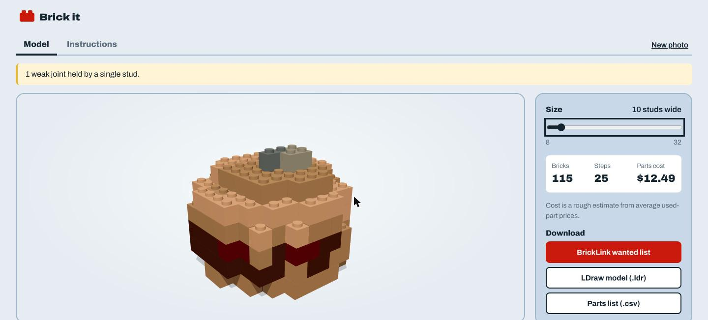
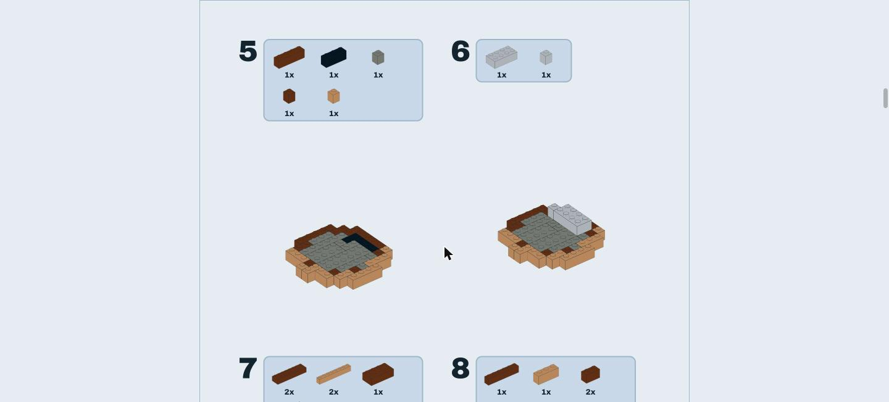

# Brick it — photo to LEGO

Take a photo of an object and get:

1. a LEGO version of it built only from real, purchasable bricks,
2. a 3D model of the build you can rotate, and
3. a step-by-step instruction booklet in the style of a real LEGO booklet (print it or save it as a PDF).

It also exports a **BrickLink Wanted List** (for ordering parts), an **LDraw** `.ldr` model, and a parts list in CSV.

Everything runs on your machine. There are no cloud APIs. The only machine learning is [TripoSR](https://github.com/VAST-AI-Research/TripoSR) (MIT), which turns the image into 3D, plus `rembg` for background removal. Every step after the mesh is ordinary algorithmic code.

| Model | Instructions |
|---|---|
|  |  |

## Quick start

Requires macOS or Linux, [uv](https://docs.astral.sh/uv/), Node 20+, and about 4 GB of free disk space for the model.

```bash
./scripts/setup.sh        # Python deps, TripoSR + weights, web deps
./scripts/dev.sh          # API on :8000, web app on :5173
```

Open http://127.0.0.1:5173.

To skip the model install, run `./scripts/setup.sh --no-model`. You can still drop a `.glb`/`.obj` file in place of a photo.

**Photo tips:** use one object on a plain background, shot from slightly above at an angle. Very small, blank, or blurry photos are rejected before the model runs.

On an 8 GB M2 MacBook Air, TripoSR takes about 30 s per photo on the GPU (MPS) and peaks at roughly 2 GB of memory. The brick engine takes under 1 s at 32 studs and up to about 5 s at the 48-stud maximum. Results are cached by image hash, so moving the size slider only reruns the engine.

## Tests

```bash
uv run pytest                 # engine + server (fast)
uv run pytest -m slow         # also runs real TripoSR on a sample photo
cd web && npm test && npm run typecheck
```

## Layout

```
engine/   pure-Python brick engine (numpy, trimesh, scipy). No web or model imports.
server/   FastAPI: TripoSR wrapper, mesh cache, input checks, build + export endpoints.
web/      Vite + React + three.js: capture, 3D viewer, instruction booklet.
docs/     design spec, implementation plan, screenshots.
```

Python and TypeScript share one contract, the **Build JSON** described in `docs/superpowers/specs/2026-10-15-lego-design.md` §3.

## How the engine works

`engine.build(mesh, size_studs)` runs seven stages, plus a slope pass after repair. Each stage is a pure function in its own module with its own tests.

**1. Voxelize** (`voxelize.py`). A LEGO brick is 8 mm per stud and 9.6 mm tall, so each voxel is one stud wide and one brick (1.2 studs) tall. The mesh is rotated to Z-up, then turned about the vertical axis so the minimum-area rectangle around its footprint lines up with the stud grid. Image-to-3D models rebuild the object in the camera's frame, so a car photographed at a ¾ angle comes out turned about 35°; left that way, its straight sides become staircases. After that the mesh is scaled so its widest horizontal extent equals the requested stud count, with Z squashed by 1.2. TripoSR meshes are not always watertight, so occupancy comes from dense surface sampling (about 40 samples per square stud) followed by 3D hole filling, not from inside/outside ray tests. Each surface sample carries a color interpolated from the vertex colors with barycentric weights, and those colors are averaged per voxel. Small voxel islands detached from the main body (image-to-3D noise) are dropped. Each voxel also records how much of its surface leans like a roof (normals 20–70° from vertical) and in which direction. It records the same for undersides that lean downward (normals 20–70° below horizontal), for inverted slopes. Flat tops, flat bottoms and vertical walls don't count, so the corner of a box isn't mistaken for a slope.

**2. Colorize** (`colors.py`). TripoSR returns noticeably darker colors than the photo it came from. On a sky-blue car, more than half the surface came out black. So the mesh colors are first quantile-matched to the photo's own foreground pixels, channel by channel in CIELAB. That restores brightness and saturation without needing to know which pixel maps to which point on the mesh. Colors are then matched to a palette of 24 common solid LEGO colors by ΔE in CIELAB, with lightness weighted down so a shadowed blue panel stays blue instead of flipping to a darker color. Colors covering less than 3% of the surface fold into the nearest common one, because real models use a handful of colors. Only visible voxels (those with an empty face neighbour) get a color. Interior voxels are marked *don't care*. Visible voxels the sampling missed take the color of the nearest sampled voxel, found with a distance transform. Two passes of a majority filter then clean up specks and ragged fringes.

**3. Hollow** (`hollow.py`). Above 12 studs, everything deeper than a 2-voxel shell is removed, except 2×2 support columns on a 6-stud lattice. That keeps every unsupported span inside the model at 4 studs or less. At 32 studs this saves roughly half the bricks.

**4. Layout** (`layout.py`). Each layer is tiled greedily with the 11-brick vocabulary (1×1 to 2×8). At the first uncovered cell in scan order, every brick that fits there is scored:
- area (bigger is better),
- the number of different bricks it would bridge in the layer below (good for connectivity),
- a penalty for each edge that lines up with a seam below (the "running bond" rule real walls follow),
- a small bonus for the layer's preferred direction, which alternates per layer.

A brick may only cover cells of one color. *Don't care* cells join any brick, and a brick made only of them becomes a hidden filler brick in light bluish gray.

**5. Validate and repair** (`structure.py`). Bricks become nodes in a graph, with edges between bricks in adjacent layers weighted by the number of shared studs. Two problems get fixed:
- **Disconnected components.** For each pair of horizontally touching cells in different components, the engine tries placing a brick in the layer above or below that spans the joint. The displaced bricks around it are re-tiled with the same greedy layout. It also tries merging across the joint within the same course (a 1×2 plus a stray cell becomes a 1×3). A change is kept only if the component count goes down. If no joint exists (a truly floating part), a 1×1 support column is dropped until it lands on something. Leftover specks of one or two bricks that still can't be joined are removed, because a real set never ships a loose 1×1.
- **Weak joints.** Tarjan's bridge-finding algorithm finds cut edges with a 1-stud overlap whose removal would split off more than one brick. The engine tries larger bricks over the joint and keeps one only if the build stays connected and the number of weak joints drops.

Anything left unfixed becomes a warning, along with a center-of-mass check against the convex hull of the base.

**5b. Slopes** (`slopes.py`). Where the object leans (a roof, a bonnet, the shoulder of a ball), staircases are smoothed with three real parts: Slope 45 2×1 (3040), Slope 45 2×2 (3039) and, where the surface leans two ways at once, Slope 45 2×2 Double Convex (3045), a corner slope with one stud. They have the same footprints as the 1×2 and 2×2 bricks. A brick becomes a slope when it's 2 studs deep in the direction the surface leans, the mesh in its front row leans that way, and its front row is exposed, with nothing beside it or on top. A 2×2 becomes a corner slope when both of its front rows lean out, nothing sits on its three stud-less cells, and its outer corner is open on both sides. Slopes only have studs where nothing sits on top, so the swap can't disconnect anything. Layout prefers long bricks, so most sloped edges start out under a 2×8. Each sloped edge cell is first re-tiled so a 1×2 or 2×2 lands there (a 2×2 with the cell on its outer corner when it leans two ways), and the repair stage runs once more to strengthen any joint the re-tiling weakened. On a 45° pyramid the corners get corner slopes, and about 90% of sloped edge cells end up under a slope. On a 16-stud sphere about 60% do. Its diagonals are one-stud staircases, too fine for a 2×2 corner to fit most steps. Undersides that lean downward (a car's front underside, the bottom of a ball) get the mirror image: Slope 45 2×1 Inverted (3665) and 2×2 Inverted (3660). A 1×2 or 2×2 becomes one when nothing is under or beside its front row and the underside there leans that way. Inverted slopes keep studs on the whole top, and nothing was under the sloped part, so this swap can't disconnect anything either. The bottom course stays plain bricks so the model stands flat.

**6. Plan steps** (`steps.py`). Real sets are built so that the model in your hands is always one piece. The planner enforces that as an invariant: every brick in every step clips onto a brick that's already placed, and a test checks this for every model. Building starts from the *foundation*: the lowest course whose largest contiguous area is at least half of the model's biggest course. For a hamburger that's the bottom bun. For a car it's the chassis, not four separate tyre patches. The build grows upward from there, lowest course first, so neighbouring courses interlock as it goes. Then the underside (wheels, legs) is attached working downward. Each step is a compact cluster of up to 6 nearby bricks across at most two neighbouring courses. Steps made only of hidden filler are batched up to 10 bricks, and 1–2 brick steps are merged into a neighbour when they fit.

**7. Export** (`export.py`). LDraw output uses LDraw color IDs and LDU coordinates (20 LDU per stud, 24 per brick, −Y up, with parts rotated about Y when their long side runs along engine-y), plus a `0 STEP` after each step so LDraw viewers replay the instructions. The BrickLink Wanted List XML and the CSV come from the same parts tally. The cost is a rough estimate from a static table of average used-part prices.

### The instruction booklet

Booklet images are rendered in the browser with three.js on an offscreen canvas: an orthographic camera at a fixed booklet-style angle, toon shading with a 3-step ramp, and black outlines built from edge geometry. The whole model is a set of instanced meshes sorted by placement order, so drawing step *n* means showing the first *k* instances and a prefix of the outline buffer, with no scene rebuild. As in real booklets, each step is framed on the part being built, and the camera never zooms in past 45% of the finished model so the scale stays steady. Pages are A4-sized HTML with print CSS, so **Print → Save as PDF** produces the booklet.

### Known limits

- One photo gives one viewpoint. TripoSR has to invent the back and the depth of the object: cars come out shorter and wider than they really are, and thin parts such as chair legs often come out fragmented. The repair stage patches those with support bricks and warnings.
- Bricks plus five 45° slopes only (three regular, two inverted). No plates, inverted corners or 1×1 corner slopes yet, so fine diagonal edges and the corners of undersides stay stepped. The grid's Z axis is already in plate units so plates can be added later.
- The stability check only warns; it does not rebalance the build.

## Notes on the model setup

- TripoSR imports `torchmcubes`, which needs a C++/CUDA build. The server injects a tiny shim backed by `PyMCubes`, so no compiler is needed.
- Recent `rembg` releases default to a 1 GB background-removal model with a non-commercial license. The server pins the original `u2net` model (MIT) instead.
- `transformers` is pinned below 4.50 for TripoSR's ViT tokenizer.

---

LEGO® is a trademark of the LEGO Group, which does not sponsor, authorize or endorse this project.
